<div align="center">

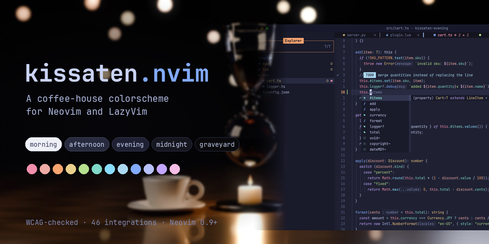

# kissaten.nvim

**A coffee-house colorscheme for Neovim and LazyVim.**

Tokyonight's crisp structure, Catppuccin's warm accents, and every syntax color checked for contrast.

[](https://neovim.io)
[](https://www.lazyvim.org)
[](https://www.lua.org)
[](#why-kissaten)
<br>
[](https://github.com/bytebeast/kissaten.nvim/actions/workflows/ci.yml)
[](https://github.com/bytebeast/kissaten.nvim/stargazers)
[](LICENSE)

<sub><i>kissaten (喫茶店): a traditional Japanese coffee house. Dim, cozy, a little retro.</i></sub>

<sub>If you try kissaten and end up using it, please ⭐ <a href="https://github.com/bytebeast/kissaten.nvim">star the repo</a>. It helps others find it.</sub>

</div>

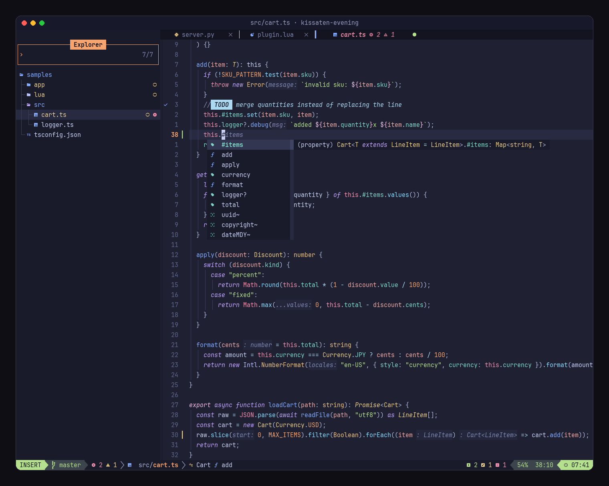

## Contents

- [Why kissaten](#why-kissaten)
- [Styles](#styles)
- [Screenshots](#screenshots)
- [Palette and color roles](#palette-and-color-roles)
- [Installation](#installation)
- [Configuration](#configuration)
- [Overrides and recipes](#overrides-and-recipes)
- [Plugin integrations](#plugin-integrations)
- [Extras](#extras)
- [Commands, API and health](#commands-api-and-health)
- [Development](#development)
- [Credits](#credits)

## Why kissaten

Tokyonight and Catppuccin are both excellent, and kissaten borrows from each on purpose. It tries to fix the things people most often complain about:

- **Readable comments and line numbers.** Tokyonight's comments sit at 2.4 to 3.1:1 contrast. Kissaten keeps comments at 4.3:1 or better and line numbers at 2.6 to 2.9:1, so they're quieter than code but never invisible.
- **A light style that actually passes.** Every syntax role in `kissaten-morning` meets WCAG AA (4.5:1). Catppuccin Latte drops to 2.3:1 for types and Tokyonight Day to 3.1:1 for functions.
- **Color carries meaning.** Structure (keywords, functions, operators) is cool. Data (strings, numbers, types) is warm. Parameters get their own hue, distinct from both numbers and builtin variables (checked with CIEDE2000), so `f(x, 42, self)` reads as three different things at a glance.
- **Color vision support.** `colorblind = "red-green"` or `"blue-yellow"` remaps the colors that carry meaning on their own (diff and git status, diagnostics) to pairs chosen by simulating each type of color blindness on every style. With the default colors, deuteranopes see "added" and "changed" as the same yellow; in red-green mode they're blue and teal.
- **JetBrains-style semantic highlighting.** `rainbow_variables` gives every local variable and parameter its own color, the way JetBrains IDEs do, from a set tuned per style so every color meets WCAG AA. Optional styles for `readonly`, `static`, global and mutable symbols use what your language server knows. And symbol references show reads and writes in different colors.
- **Semantic layers instead of 1,600 hex codes.** Palette, then roles (`colors.syn.parameter`, `colors.diag.warn`, ...), then highlight groups. Change one role and every language and plugin follows.
- **No cache, nothing to go stale.** Building all 1,600+ groups takes about 1 ms, so kissaten rebuilds them on every load and your changes always show up. Applying the theme in a real LazyVim startup takes about 7–8 ms, most of it Neovim itself setting the highlights. (A bytecode cache was tried and measured. It saved about 1 ms and added stale-cache edge cases, so it was left out.)
- **Robust.** Typos in your config produce a warning and a fallback, never a broken editor. CI tests every release on Neovim 0.9, 0.10, 0.11, stable and nightly.

<details>
<summary><b>Measured contrast vs. Tokyonight and Catppuccin</b></summary>

Ratios against each theme's own `Normal` background, read from the live highlight groups in Neovim 0.12 (higher is more readable; WCAG AA for text is 4.5).

| Tier | Theme | Lowest syntax role | Comments | Line numbers |
| --- | --- | --- | --- | --- |
| Light | **kissaten-morning** | **4.6** | **4.3** | **2.6** |
| | tokyonight-day | 3.1 | 2.5 | 1.7 |
| | catppuccin-latte | 2.3 | 3.5 | 1.6 |
| Mid | **kissaten-afternoon** | **5.9** | 4.5 | **2.9** |
| | tokyonight-storm | 4.4 | 2.4 | 1.5 |
| | catppuccin-frappe | 5.3 | 4.5 | 1.7 |
| Dark | **kissaten-evening** | **6.9** | 4.5 | **2.8** |
| | tokyonight-moon | 6.7 | 3.1 | 1.6 |
| | catppuccin-macchiato | 6.6 | 5.3 | 1.8 |
| Darkest | **kissaten-midnight** | 7.1 | 4.7 | **2.8** |
| | tokyonight-night | 5.1 | 2.8 | 1.7 |
| | catppuccin-mocha | **7.8** | **5.8** | 1.8 |
| Black | **kissaten-graveyard** | 7.1 | 4.7 | **2.8** |
| | *(neither has a black style)* | | | |

Roles measured: keyword, function, string, type, parameter, property, number and operator. Catppuccin deliberately keeps brighter comments in its dark flavors. If you prefer that, set `contrast = "high"`, which lifts kissaten's comments to 6:1 or better.

</details>

## Styles

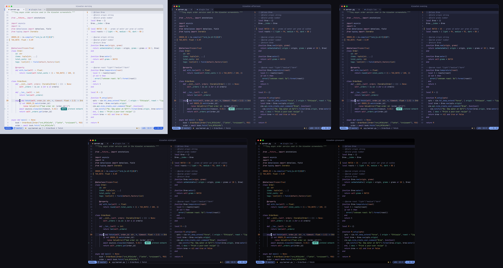

| Style | Background | Character |
| --- | --- | --- |
| `kissaten-morning` | light | Bright paper with deep, AA-contrast inks |
| `kissaten-afternoon` | dark | Slate blue, a softer mid-tone (storm/frappé territory) |
| `kissaten-evening` | dark | Cool navy with warm café accents. **Default** |
| `kissaten-midnight` | dark | Near-black ink for low-light sessions |
| `kissaten-graveyard` | dark | Black, for OLED screens and dark rooms. Midnight's colors, matched to the same contrast |

`:colorscheme kissaten` follows `'background'`: dark loads your `style`, light loads `light_style`. Flip `'background'` and kissaten switches to the matching variant and remembers which one you used last.

## Screenshots

All screenshots are real LazyVim sessions (vtsls and pyright for LSP, treesitter for everything else), rendered by [`scripts/screenshot.py`](scripts/screenshot.py).

| | |
| --- | --- |
| 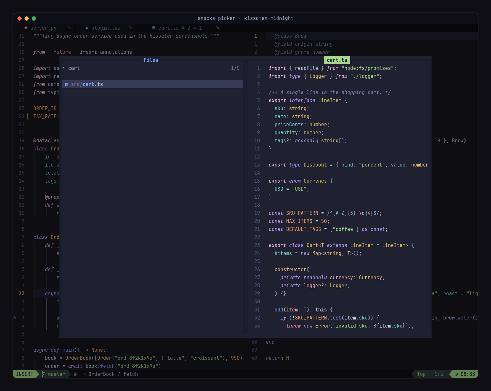 | 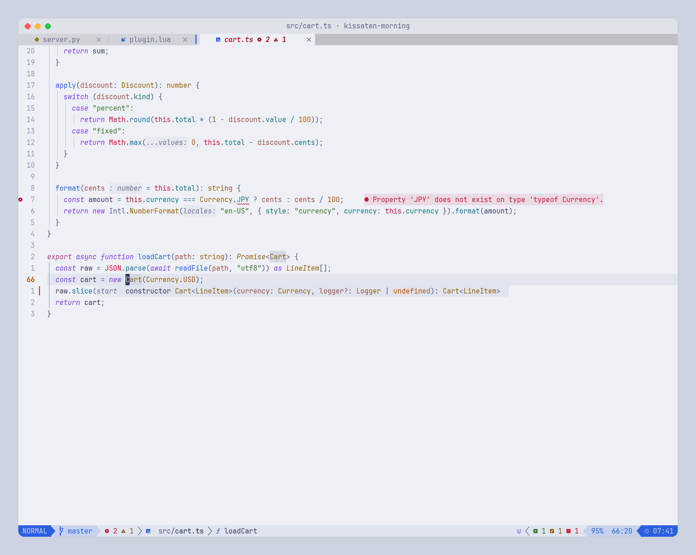 |
| **Picker** · midnight | **Diagnostics and hover** · morning |
| 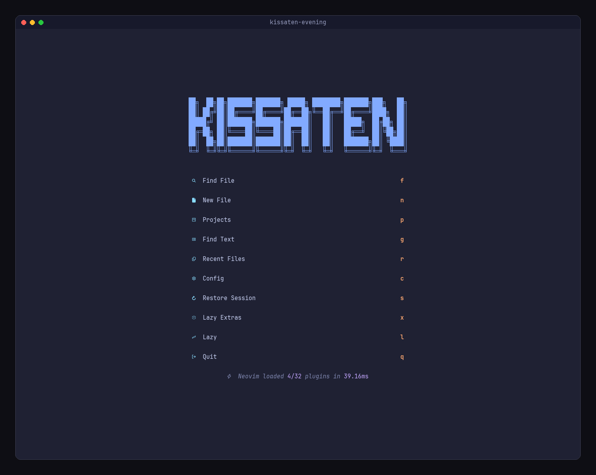 | 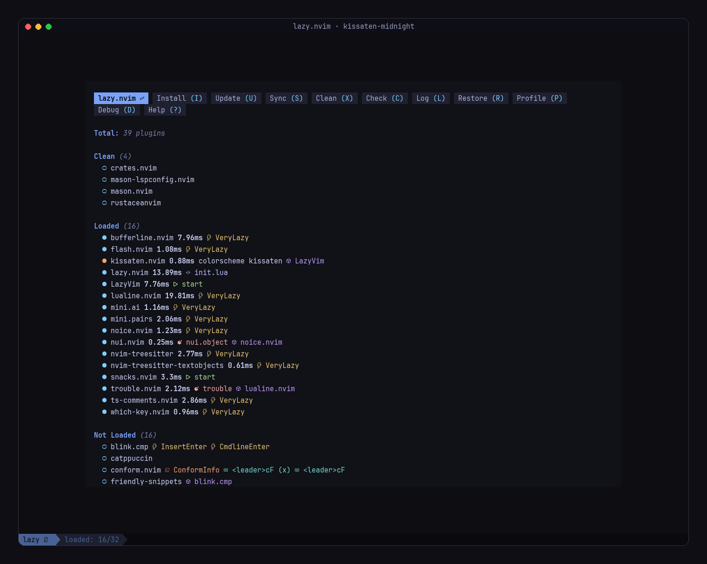 |
| **Dashboard** · evening | **lazy.nvim** · midnight |

## Palette and color roles

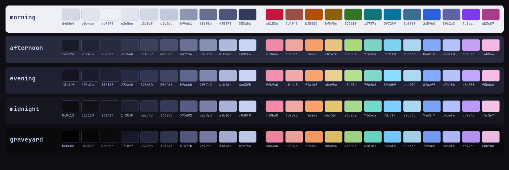

<details>
<summary><b>Full palette cards: every swatch with its hex, derived UI colors and syntax roles</b></summary>

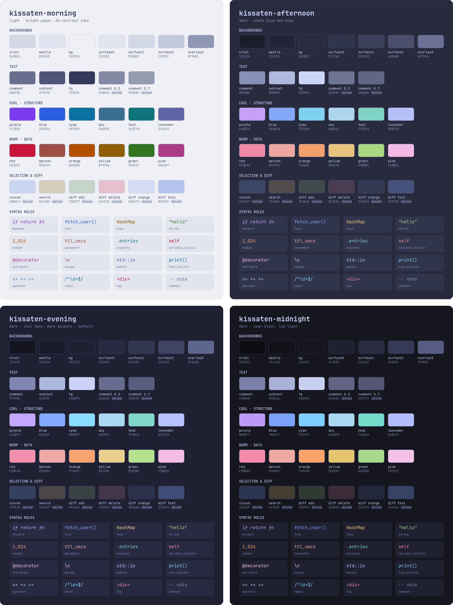

Swatches marked *derived* aren't in the palette files. Kissaten computes them from the palette (selection, search, diff backgrounds, and the `subtle_comments` fades), so they follow any palette change automatically. The syntax tiles are drawn in the real role colors that the plugin computes.
</details>

Each style has 10 base tones (`crust` to `fg`) and 12 accents. The accents have fixed jobs in every style:

| Accent | Role in code | Also used for |
| --- | --- | --- |
| `purple` | keywords (`if`, `return`, `local`, `class`) | |
| `blue` | functions and methods | directories, titles, normal mode |
| `cyan` | builtin functions, regex | |
| `sky` | operators | info diagnostics |
| `teal` | properties and fields | hints, symbols, URLs |
| `green` | strings | additions, ok |
| `yellow` | types, classes, constructors (interfaces in italic) | warnings, git changes |
| `orange` | numbers, constants, booleans | current line number, search |
| `maroon` | parameters | |
| `red` | `self`/`this`, HTML tags, exceptions | errors, deletions |
| `lavender` | modules and namespaces | indent scope |
| `pink` | macros, decorators, imports, escapes | flash/leap labels |

## Installation

Requires Neovim **0.9+** with a true-color terminal and a [Nerd Font](https://www.nerdfonts.com) for icons.

> **Font:** the screenshots use **JetBrains Mono Nerd Font** (`brew install --cask font-jetbrains-mono-nerd-font`). See the **[font guide](extras/fonts/README.md)** for other good coding fonts, how to set them up in Ghostty, iTerm2, Kitty, WezTerm, Alacritty, Windows Terminal, VS Code and Neovide, and how to turn ligatures on or off.

### LazyVim

```lua
-- ~/.config/nvim/lua/plugins/colorscheme.lua
return {
  {
    "bytebeast/kissaten.nvim",
    lazy = false,
    priority = 1000,
    -- version = "*", -- uncomment to stay on tagged releases
    opts = {
      -- Styles: "morning" (light) | "afternoon" | "evening" | "midnight" | "graveyard" (black)
      style = "evening", -- dark style used by `colorscheme kissaten`
      light_style = "morning", -- used when vim.o.background == "light"

      transparent = false, -- true: don't paint the background (terminal blur, tmux)
      terminal_colors = true, -- theme the colors of :terminal
      dim_inactive = false, -- true: darken windows you're not working in

      -- "normal" | "high" (brighter comments, line numbers and UI hints)
      contrast = "normal",

      -- Let comments fade behind the code:
      --   false                 off (comments at ~4.5:1 contrast)
      --   true or 0.5           gently faded (~3:1)
      --   { fade = 0.7 }        clearly faded (~2.5:1); 0 = off, 1 = faintest (1.6:1)
      --   { fade = 0.7, docstrings = false }  fade comments, keep docstrings
      subtle_comments = false,

      -- Color vision: false | "red-green" (protan/deutan) | "blue-yellow" (tritan)
      colorblind = false,
      -- Color intensity: 1 = full color, 0.5 = muted, 0 = greys (contrast is kept;
      -- diff/git/diagnostic colors keep at least 70%, all of it with colorblind)
      saturation = 1,
      -- UI accent for titles, matches, normal mode, selected tab:
      -- "blue" | "lavender" | "purple" | "pink" | "red" | "maroon" | "orange"
      -- | "yellow" | "green" | "teal" | "cyan" | "sky"
      -- (a statusline mode that shares the accent's color switches to blue)
      accent = "blue",
      -- Rainbow brackets and indent scopes: "vivid" | "dimmed" | "mono" (greys)
      rainbow = "vivid",
      borderless = false, -- true: pickers without border lines, framed by shade
      -- (how options combine: README "Combining options")

      -- JetBrains-style: every local variable and parameter gets its own color
      -- (needs an LSP with semantic tokens; 6 colorblind-safe colors with colorblind)
      rainbow_variables = false,

      diagnostics = {
        underline = "undercurl", -- "undercurl" | "underline" | false
        virtual_text = "tinted", -- "tinted" (colored background) | "plain"
      },
      inlay_hints = "tinted", -- "tinted" | "plain"

      -- Text attributes per category. Use any of:
      -- italic, bold, underline, undercurl, strikethrough, reverse
      -- (options merge with the defaults: use italic = false to turn one off)
      styles = {
        comments = { italic = true },
        keywords = { italic = true },
        -- conditionals = { bold = true }, -- if/else/switch (default: same as keywords)
        -- loops = { bold = true }, -- for/while (default: same as keywords)
        virtual_text = {}, -- diagnostic virtual text, e.g. { italic = true }
        inlay_hints = { italic = true },
        -- LSP modifiers, stacked on the symbol's color (needs an LSP):
        mutable = { underline = true }, -- `mut` bindings (Rust); { underline = false } = off
        readonly = {}, -- const / readonly / final, e.g. { italic = true }
        statics = {}, -- static members, e.g. { bold = true }
        globals = {}, -- global scope (clangd, LuaLS), e.g. { underdotted = true }
        functions = {}, -- e.g. { bold = true }
        variables = {},
        parameters = {}, -- e.g. { italic = true }
        types = {},
        strings = {},
        constants = {},
        -- Backgrounds: "dark" | "normal" | "transparent"
        sidebars = "dark", -- file explorer, trouble, outline, ...
        floats = "dark", -- pickers, hover docs, popups
      },

      -- Global switches that win over everything above
      no_italic = false, -- true for fonts without italics
      no_bold = false,
      no_underline = false,

      -- true: accent-colored popup borders.
      -- NOTE: bright_borders needs this in lua/config/options.lua to work
      -- effectively (Neovim 0.11+), otherwise completion/hover popups have no
      -- border to color:
      --   vim.o.winborder = "rounded"
      bright_borders = false,
      lualine_bold = false, -- true: bold mode section in the statusline

      -- Recolor anything (see README "Overrides and recipes"):
      -- on_colors = function(c) c.syn.parameter = c.yellow end,
      -- on_highlights = function(hl, c) hl.CursorLineNr = { fg = c.orange, bold = true } end,
    },
  },
  {
    "LazyVim/LazyVim",
    opts = {
      -- "kissaten" follows vim.o.background; or pin one:
      -- "kissaten-morning" | "kissaten-afternoon" | "kissaten-evening" | "kissaten-midnight" | "kissaten-graveyard"
      colorscheme = "kissaten",
    },
  },
}
```

### lazy.nvim

```lua
{
  "bytebeast/kissaten.nvim",
  lazy = false,
  priority = 1000,
  config = function()
    require("kissaten").setup({ style = "evening" })
    vim.cmd.colorscheme("kissaten")
  end,
}
```

### vim.pack (Neovim 0.12+)

```lua
vim.pack.add({ "https://github.com/bytebeast/kissaten.nvim" })
vim.cmd.colorscheme("kissaten-midnight")
```

Calling `setup()` is optional. Without it you get the defaults below.

## Configuration

These are the defaults. You only need to pass what you want to change.

```lua
require("kissaten").setup({
  style = "evening",          -- dark style: "afternoon" | "evening" | "midnight" | "graveyard"
  light_style = "morning",    -- used when vim.o.background == "light"
  transparent = false,        -- don't paint the editor background
  terminal_colors = true,     -- set vim.g.terminal_color_0..15 for :terminal
  dim_inactive = false,       -- darken non-current windows
  contrast = "normal",        -- "high" lifts comments, line numbers and UI hints
  subtle_comments = false,    -- fade comments behind code: true | 0..1 | { fade = 0.7, docstrings = true }
  colorblind = false,         -- false | "red-green" | "blue-yellow"
  saturation = 1,             -- 0 (greys) .. 1 (full color); contrast is kept
  accent = "blue",            -- UI accent: any palette accent name
  rainbow = "vivid",          -- brackets and indent scopes: "vivid" | "dimmed" | "mono"
  borderless = false,         -- pickers framed by shade instead of border lines
  rainbow_variables = false,  -- a color per local variable and parameter (LSP)

  diagnostics = {
    underline = "undercurl",  -- "undercurl" | "underline" | false
    virtual_text = "tinted",  -- "tinted" | "plain"
  },
  inlay_hints = "tinted",     -- "tinted" | "plain"

  styles = {
    -- any nvim_set_hl attributes: italic, bold, underline, ...
    comments = { italic = true },
    keywords = { italic = true },
    -- conditionals = {},     -- if/else/switch; unset = same as keywords
    -- loops = {},            -- for/while; unset = same as keywords
    virtual_text = {},        -- diagnostic virtual text
    inlay_hints = { italic = true },
    mutable = { underline = true }, -- LSP modifiers: `mut` bindings
    readonly = {},            -- const / readonly / final
    statics = {},             -- static members
    globals = {},             -- global scope
    functions = {},
    variables = {},
    parameters = {},
    types = {},
    strings = {},
    constants = {},
    -- background treatment: "dark" | "normal" | "transparent"
    sidebars = "dark",
    floats = "dark",
  },

  no_italic = false,          -- global kill switches
  no_bold = false,
  no_underline = false,

  bright_borders = false,     -- accent-colored popup borders
                              -- NOTE: needs vim.o.winborder = "rounded" to work effectively
  lualine_bold = false,       -- bold mode section in the lualine themes

  on_palette = function(palette, style) end,       -- 1. raw colors
  on_colors = function(colors) end,                -- 2. semantic roles
  on_highlights = function(highlights, colors) end, -- 3. highlight groups

  plugins = {
    all = nil,   -- nil: load all integrations only when no plugin manager is detected
    auto = true, -- enable integrations for plugins lazy.nvim / vim.pack know about
    -- telescope = true, ["fzf-lua"] = false, ...
  },
})
```

### Combining options

Every option can be combined with every other. The test suite loads each pair on every style and checks that WCAG AA, badge contrast, colorblind separation and distinct statusline modes all still hold. Where two options touch the same thing, this is who wins:

| Combination | What happens |
| --- | --- |
| `saturation` + `colorblind` | Syntax gets muted. Diff, git and diagnostic colors keep full color, because colorblind mode depends on their hue. |
| `saturation` (alone) | Status colors (diff, git, diagnostics) and statusline modes keep at least 70% of their color, so error, warn and ok never turn the same grey. Everything else follows `saturation` down to 0. |
| `saturation` + `on_palette` | Colors you set in `on_palette` are muted too (the palette hook runs first). Use `on_colors` for a color that should stay vivid. |
| `colorblind` + `on_colors` | `on_colors` runs last, so your role changes win. |
| `accent` + statusline modes | Normal mode uses the accent. A mode that would share its color (insert is green, visual purple, replace red, command orange, terminal teal) switches to blue, so no two modes look alike. |
| `accent` + `colorblind` | Allowed, but an accent that's also a status color can blur the two meanings, e.g. `accent = "orange"` with `"red-green"`, where deleted lines are orange. |
| `bright_borders` + popups without borders | Nothing visible changes on windows that draw no border (LazyVim's completion menu and hover by default). Set `vim.o.winborder = "rounded"`; see [Borders around popups](#overrides-and-recipes). |
| `borderless` + `bright_borders` | Pickers stay borderless. `bright_borders` still styles every other float (hover, completion docs, LSP info). |
| `borderless` + `transparent` | Picker panels stay solid. Without lines, the shade is all that frames them. |
| `rainbow_variables` + `colorblind` | Variables use 6 colors that type can tell apart (two hues, three lightness steps) instead of 12. |
| `rainbow_variables` + `saturation` | Like status colors, variable colors keep their hue, so they stay apart even at `0`. |
| `rainbow_variables` + `styles.readonly` / `mutable` / ... | They stack: a `const` local keeps its own color and gets the readonly style on top. |
| `contrast = "high"` + `subtle_comments` | They compose: comments fade starting from the lifted contrast (`0.5` gives about 3.8:1 instead of 3.1:1). |
| `no_italic` / `no_bold` / `no_underline` | Global kill switches. They beat `styles.*` and `diagnostics.underline`. |
| `transparent` + tinted virtual text / inlay hints | The tints are still drawn as small colored backgrounds; set `"plain"` for a fully see-through look. |

## Overrides and recipes

Overrides happen in three layers. Prefer the highest layer that does the job, because lower layers have to be repeated for every group.

| Hook | You get | Use it to |
| --- | --- | --- |
| `on_palette(palette, style)` | raw palette for one style | change a base color, such as a darker background for one style |
| `on_colors(colors)` | semantic roles: `colors.syn`, `colors.ui`, `colors.diag`, `colors.git`, `colors.diff`, `colors.brackets` | change what a color *means* everywhere |
| `on_highlights(hl, colors)` | every highlight group | tweak individual groups |

<details open>
<summary><b>Recolor a role everywhere (recommended)</b></summary>

```lua
opts = {
  on_colors = function(c)
    c.syn.parameter = c.yellow  -- parameters in yellow, in every language
    c.syn.keyword = c.pink
    c.diag.hint = c.lavender    -- hint diagnostics, virtual text, signs, ...
  end,
}
```
</details>

<details>
<summary><b>Darker background for one style only</b></summary>

```lua
opts = {
  on_palette = function(p, style)
    if style == "midnight" then
      p.bg = "#0f0f15"
      p.mantle = "#0a0a0f"
    end
  end,
}
```

For black, use `kissaten-graveyard` instead. It already re-tunes the text colors and tints for a black background. If you darken a style yourself, also raise `p._tint` (default `1`, graveyard uses `1.15`) so selection, search and diff backgrounds stay visible.
</details>

<details>
<summary><b>Transparent background (terminal blur, tmux)</b></summary>

```lua
opts = {
  transparent = true,
  styles = { sidebars = "transparent", floats = "transparent" },
}
```
</details>

<details>
<summary><b>High contrast, no italics</b></summary>

```lua
opts = {
  contrast = "high", -- comments >= 6:1, brighter line numbers and punctuation
  no_italic = true,  -- for fonts without italics
}
```
</details>

<details open>
<summary><b>Subtle comments: let comments fade behind the code</b></summary>

```lua
opts = {
  subtle_comments = 0.5,              -- gently faded
  -- subtle_comments = { fade = 0.7 }, -- clearly faded
  -- subtle_comments = { fade = 0.7, docstrings = false }, -- fade comments, keep docstrings
}
```

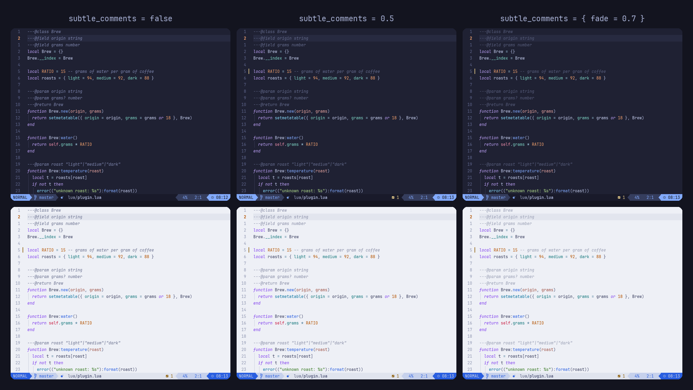

`fade` runs from `0` (off) to `1`. It's measured in contrast rather than opacity, so the same value looks the same in every style, from `morning` to `graveyard`, and `1` stops at 1.6:1 so comments never disappear:

| `fade` | Comment contrast (all styles) |
| --- | --- |
| off | 4.3 – 4.7 : 1 |
| `0.5` | 3.0 – 3.2 : 1 |
| `0.7` | 2.4 – 2.5 : 1 |
| `1` | 1.6 : 1 |

Only code comments and (by default) docstrings fade. TODO/FIXME/NOTE badges, inlay hints, ghost text and the statusline keep their normal contrast. `on_colors` can still set `c.syn.comment` to anything you like.
</details>

<details open>
<summary><b>Colorblind mode</b></summary>

```lua
opts = {
  colorblind = "red-green",     -- protanopia / deuteranopia (about 1 in 12 men)
  -- colorblind = "blue-yellow", -- tritanopia
}
```

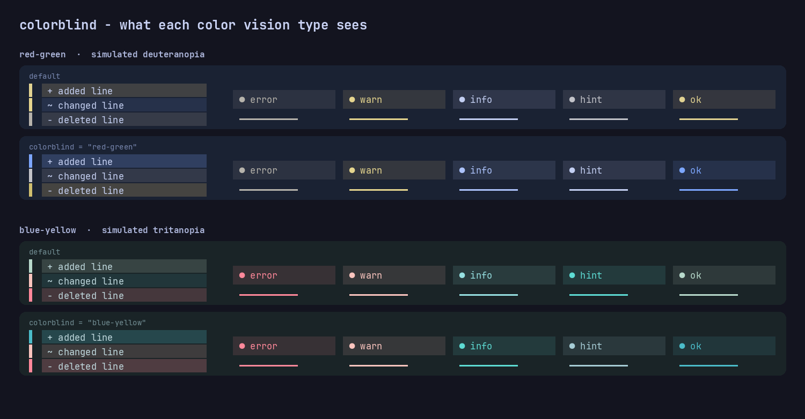

Only colors that carry meaning *on their own* change: diff and git status (gutter signs, diff lines, file trees, neogit, grug-far, ...) and diagnostics (signs, underlines, virtual text, neotest, mason, ...). Syntax colors stay as they are, since code is also read by shape, position and italics.

The colors were chosen by simulating each deficiency (Machado et al. 2009, full severity) on all five styles and picking the palette colors that stay furthest apart. That's the same approach as GitHub's colorblind themes, and it lands on similar choices: added and ok become blue, and in red-green mode deleted becomes orange. The light style gets its own diagnostic colors because its deeper inks need them. Diff backgrounds also mix in 25% more color. The test suite re-runs the simulation and fails if any pair gets too close.

| | added / changed / deleted | error / warn / ok / info / hint |
| --- | --- | --- |
| default | green / yellow / red | red / yellow / green / sky / teal |
| `"red-green"` | blue / teal / orange | red / yellow / blue / lavender / sky (`morning`: pink / orange / blue / cyan / maroon) |
| `"blue-yellow"` | blue / yellow / red | red / yellow / blue / teal / lavender |

Under `"blue-yellow"`, error vs. warn and changed vs. deleted differ more by lightness than by hue, because tritanopia leaves few hues to choose from. GitHub's tritanopia theme makes the same trade. `on_colors` still has the last word if you want to tune a role.
</details>

<details>
<summary><b>Saturation: a calmer, more muted look</b></summary>

```lua
opts = {
  saturation = 0.6, -- 1 = full color, 0 = greys
}
```

Color intensity is scaled in OKLab, a color space where lightness is perceptual. Then each color's original contrast against the background is restored exactly. So `0.6` looks muted, not darker or washed out, every syntax color still meets WCAG AA, and comments keep their place in the hierarchy. At `0` the theme is greyscale, told apart by lightness alone. HSL-based desaturation, which some themes use, can't do this: it darkens yellows and brightens blues as it removes color.

Colors that carry meaning by hue keep more of it: diff, git and diagnostic colors and the statusline modes never drop below 70% (and keep all of it with `colorblind`), so error, warn and ok stay apart even at `0`.
</details>

<details>
<summary><b>Accent color</b></summary>

```lua
opts = { accent = "pink" } -- any palette accent: "lavender", "teal", "orange", ...
```

Moves the UI accent (float and picker titles, match highlights, the normal-mode statusline, the selected tab and buffer, dashboard headers, the command-line popup) to another palette color. Code colors don't change: functions and directories stay blue. Text on accent badges keeps at least 4.5:1 for every accent on every style. If the accent is a mode's color (`"green"` is insert mode's), that mode switches to blue so the two never look the same.
</details>

<details>
<summary><b>Rainbow brackets: vivid, dimmed or mono</b></summary>

```lua
opts = {
  rainbow = "dimmed", -- softer colors (70% of their contrast, never below 3:1)
  -- rainbow = "mono", -- greys from bright (outermost) to dim (innermost)
}
```

Applies to [rainbow-delimiters.nvim](https://github.com/HiPhish/rainbow-delimiters.nvim) and snacks' rainbow indent scopes. Markdown headings keep their colors.
</details>

<details>
<summary><b>Diagnostics and inlay hints</b></summary>

```lua
opts = {
  diagnostics = {
    underline = "underline", -- "undercurl" (default) | "underline" | false
    virtual_text = "plain",  -- "tinted" (default, colored background) | "plain"
  },
  inlay_hints = "plain",     -- "tinted" (default) | "plain"
  styles = {
    virtual_text = { italic = true },
    inlay_hints = { italic = false },
  },
}
```

Plain underlines help in terminals that draw undercurl poorly (or not at all, as in some tmux setups). `underline = false` leaves only signs and virtual text.
</details>

<details>
<summary><b>Bold control flow</b></summary>

```lua
opts = {
  styles = {
    conditionals = { bold = true }, -- if / else / switch / case
    loops = { bold = true },        -- for / while / repeat
  },
}
```

Unset, both follow `styles.keywords`. Setting one replaces the keyword style for that category: `{ bold = true }` here means bold and not italic. Options merge with the defaults, so to turn off an attribute that's on by default, set it to `false` (for example, `comments = { italic = false }`).
</details>

<details open>
<summary><b>Rainbow variables (JetBrains-style semantic highlighting)</b></summary>

```lua
opts = { rainbow_variables = true }
```

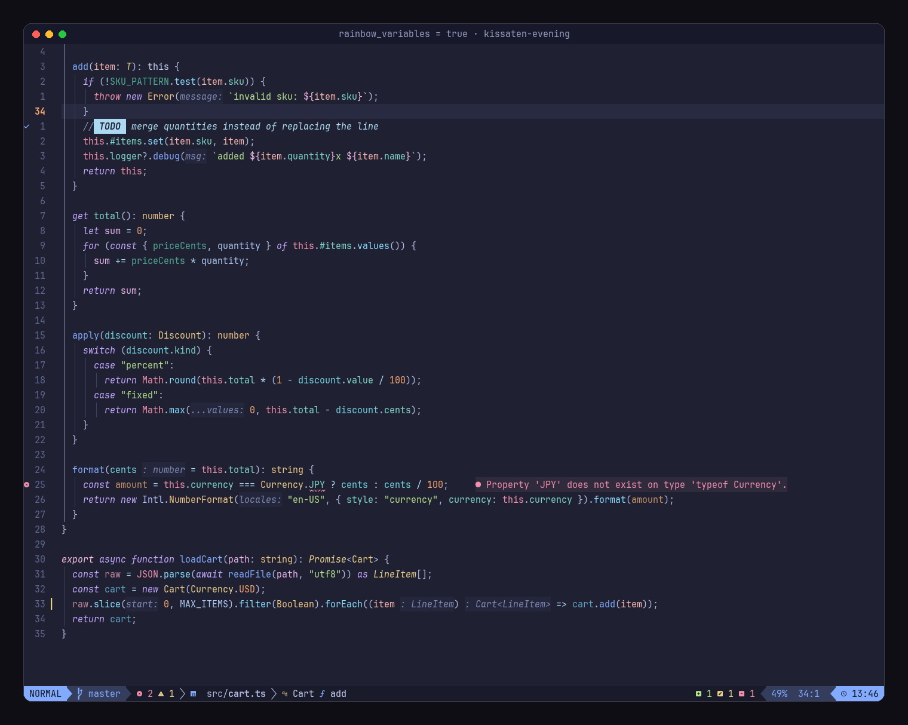

Every local variable and parameter gets a color picked from its name, so `sum` is the same color everywhere it appears and `sum`, `raw` and `cart` are easy to tell apart. Properties, functions and types keep their usual colors, and library globals like `console` are skipped.

- **Needs** an LSP that sends semantic tokens: vtsls, rust-analyzer, clangd, LuaLS, basedpyright, gopls (with its `semanticTokens = true` setting, which LazyVim's Go extra turns on), and others. Treesitter alone doesn't know which names are variables.
- **12 colors**, evenly spaced hues in two lightness tiers, tuned to each style's own accents. All meet WCAG AA, and the nearest two are at least 6.5 apart in OKLab (3 is about the smallest difference you can see side by side).
- **With `colorblind`**, it uses 6 colors on the hues that type keeps apart (blue and yellow for red-green, red and teal for blue-yellow), at three lightness steps.
- Two different names can land on the same color, since 12 colors cover any number of names. JetBrains IDEs share this limit.
- `:checkhealth kissaten` shows whether it's active.
</details>

<details>
<summary><b>LSP modifiers: readonly, static, global and mutable symbols</b></summary>

```lua
opts = {
  styles = {
    readonly = { italic = true },     -- const / readonly / final
    statics = { bold = true },        -- static members
    globals = { underdotted = true }, -- global scope
    mutable = { underline = true },   -- `mut` bindings (the default)
  },
}
```

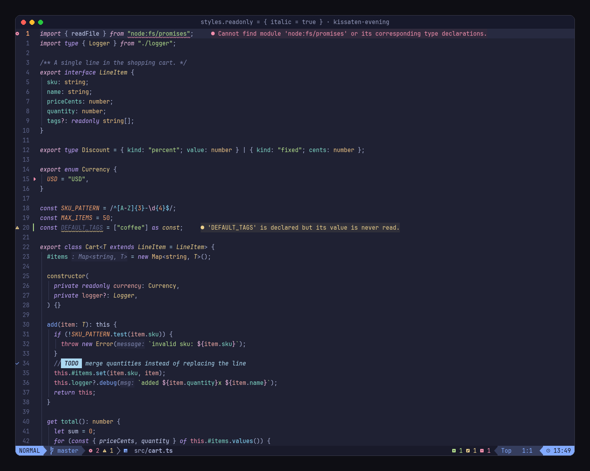

These use what your language server knows and the parser doesn't. JetBrains IDEs make the same distinctions. Each style is added on top of the symbol's normal color, so they combine with `rainbow_variables`. Which ones appear depends on the server: TypeScript (vtsls) reports `readonly` and `static`; rust-analyzer reports `mutable`; clangd and LuaLS report global scope. Only `mutable` is on by default. To turn it off, set `mutable = { underline = false }`.
</details>

<details>
<summary><b>Read vs. write references (and a fix for TypeScript)</b></summary>

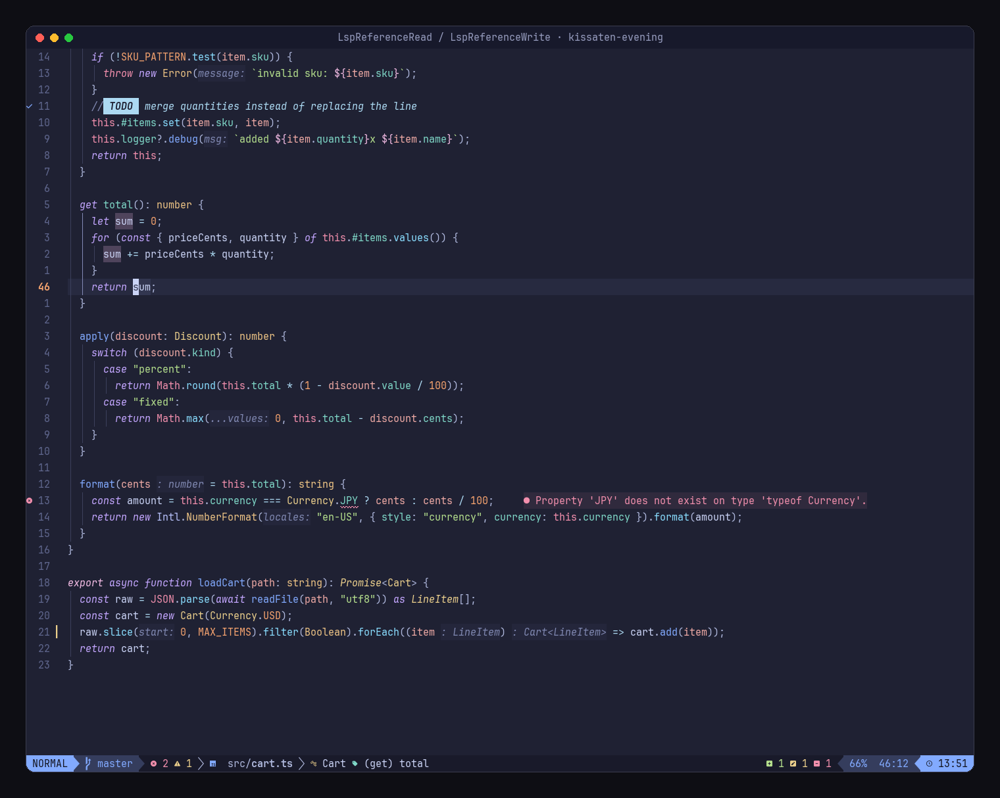

When your cursor rests on a symbol, LSP document highlights mark every other use of it (in LazyVim through snacks words or vim-illuminate). Kissaten shows **reads** on a neutral shade and **writes** (assignments, `+=`, declarations) on a pink tint. The two stay apart with color blindness too, and pink doesn't clash with search, selection or diff colors.

**TypeScript in LazyVim:** vtsls (0.3.0) sends VS Code's 0-based highlight kinds instead of the LSP's 1-based ones, so writes arrive labeled as reads and reads as plain text, and every use looks the same. Shift them back in your LSP config:

```lua
-- lua/plugins/lsp.lua
return {
  "neovim/nvim-lspconfig",
  opts = {
    servers = {
      vtsls = {
        handlers = {
          ["textDocument/documentHighlight"] = function(err, result, ctx, config)
            for _, h in ipairs(result or {}) do
              h.kind = (h.kind or 0) + 1 -- VS Code 0-based -> LSP 1-based
            end
            return vim.lsp.handlers["textDocument/documentHighlight"](err, result, ctx, config)
          end,
        },
      },
    },
  },
}
```

Servers that follow the LSP numbering (rust-analyzer, gopls, clangd, LuaLS, ...) need nothing.
</details>

<details>
<summary><b>Follow your OS light/dark mode</b></summary>

Kissaten follows Neovim's `background` option: dark loads `style`, light loads `light_style`. [auto-dark-mode.nvim](https://github.com/f-person/auto-dark-mode.nvim) sets `background` when macOS, Windows or Linux (GNOME, KDE, darkman) switches, so pairing the two is all it takes:

```lua
-- lua/plugins/colorscheme.lua (alongside kissaten)
return {
  { "f-person/auto-dark-mode.nvim", opts = {} }, -- its defaults set 'background'
  {
    "bytebeast/kissaten.nvim",
    lazy = false,
    priority = 1000,
    opts = { style = "evening", light_style = "morning" },
  },
  { "LazyVim/LazyVim", opts = { colorscheme = "kissaten" } },
}
```

Use `colorscheme = "kissaten"` (not a pinned style like `kissaten-evening`) so the switch can happen.
</details>

<details>
<summary><b>Per-language overrides</b></summary>

Neovim's highlight groups take a language suffix, so `on_highlights` can change one language without touching the others:

```lua
opts = {
  on_highlights = function(hl, c)
    hl["@variable.member.python"] = { fg = c.orange }               -- treesitter, Python only
    hl["@lsp.type.variable.lua"] = { fg = c.pink, italic = true }   -- semantic tokens, Lua only
    hl["@markup.heading.1.markdown"] = { fg = c.yellow, bold = true }
  end,
}
```

Run `:Inspect` with the cursor on any text to see which groups color it.
</details>

<details>
<summary><b>Override specific highlight groups</b></summary>

```lua
opts = {
  on_highlights = function(hl, c)
    hl.CursorLineNr = { fg = c.yellow, bold = true }
    hl.LineNr = { fg = c.comment }
    hl.WinSeparator = { fg = c.surface2 }
    hl["@variable.member"] = "@property" -- a string is shorthand for a link
    hl.Visual = { bg = c.surface2, bold = true }
  end,
}
```
</details>

<details>
<summary><b>Borders around popups (completion, hover, signature help)</b></summary>

> **Note:** `bright_borders` needs `vim.o.winborder = "rounded"` (Neovim 0.11+) to work effectively.

`bright_borders` colors popup borders in the accent color, but a colorscheme can only color a border that a window actually draws. In LazyVim the completion menu, its docs and the LSP hover have no border by default. They follow Neovim's `winborder` option, which is empty. Turn borders on once and `bright_borders` takes effect everywhere:

```lua
-- LazyVim: lua/config/options.lua (Neovim 0.11+)
vim.o.winborder = "rounded" -- or "single", "double", "bold", "solid"
```

```lua
-- kissaten opts
opts = { bright_borders = true }
```

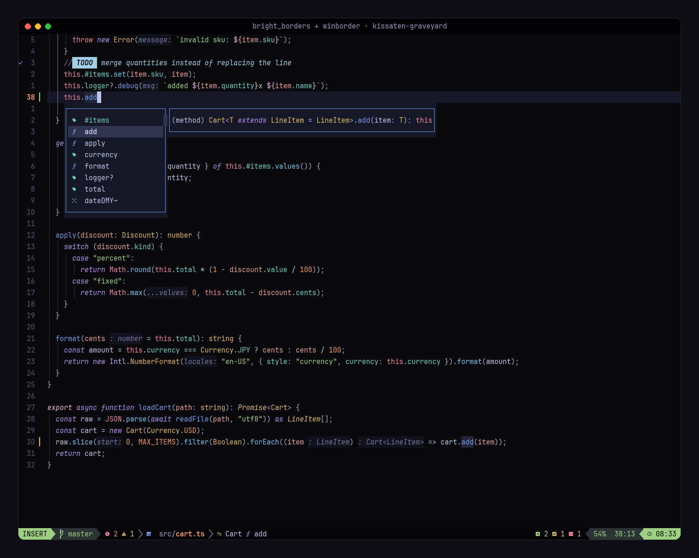

blink.cmp and snacks use `winborder` when their own border is unset. To give only the completion menu a border, set it in blink instead: `opts = { completion = { menu = { border = "rounded" }, documentation = { window = { border = "rounded" } } } }` on `saghen/blink.cmp`.

Even without borders, popups stand apart from the editor on every style. On `midnight` and `graveyard`, where there's no room for a darker shade, floats and the completion menu sit a step lighter than the background instead.
</details>

<details>
<summary><b>Borderless pickers</b></summary>

```lua
opts = { borderless = true }
```

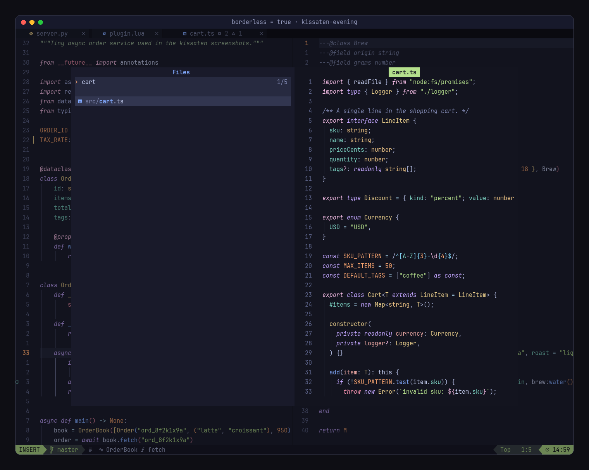

Telescope, snacks and fzf-lua lose their border lines. The prompt, list and preview are told apart by background shade instead (prompt a step lighter than the editor, list on the float shade, preview the deepest), and titles become colored badges. On `midnight` and `graveyard`, where there's no room below the background, the prompt and list are lifted above it instead. The panels stay solid even with `transparent = true`, since without lines the shade is all that frames them.
</details>

<details>
<summary><b>Use kissaten colors in your own config</b></summary>

```lua
local c = require("kissaten").colors() -- active style, or pass "midnight"
vim.api.nvim_set_hl(0, "MyTodoBadge", { fg = c.ui.on_badge, bg = c.syn.keyword, bold = true })

-- e.g. a lualine component
{ function() return " brewing" end, color = { fg = c.orange } }
```
</details>

<details>
<summary><b>Choose integrations manually</b></summary>

```lua
opts = {
  plugins = {
    all = false,        -- don't load everything
    auto = false,       -- don't ask the plugin manager
    telescope = true,   -- by module name
    ["gitsigns.nvim"] = true, -- or by repo name
  },
}
```
</details>

<details>
<summary><b>Different styles for light and dark terminals</b></summary>

```lua
opts = { style = "midnight", light_style = "morning" }
-- then just :set background=light / dark (or let your terminal do it)
```
</details>

## Plugin integrations

With lazy.nvim, and with `vim.pack` on Neovim 0.12+, kissaten loads integrations only for plugins you actually have. Run `:checkhealth kissaten` to see which ones are active. Built-in LSP, diagnostics, treesitter, semantic tokens and `:terminal` are always covered.

<details>
<summary><b>All 46 integrations</b></summary>

| Plugin | Module |
| --- | --- |
| [aerial.nvim](https://github.com/stevearc/aerial.nvim) | `aerial` |
| [alpha-nvim](https://github.com/goolord/alpha-nvim) | `alpha` |
| [barbar.nvim](https://github.com/romgrk/barbar.nvim) | `barbar` |
| [blink.cmp](https://github.com/Saghen/blink.cmp) | `blink` |
| [bufferline.nvim](https://github.com/akinsho/bufferline.nvim) | `bufferline` |
| [nvim-cmp](https://github.com/hrsh7th/nvim-cmp) | `cmp` |
| [copilot.lua / copilot.vim](https://github.com/zbirenbaum/copilot.lua) | `copilot` |
| [nvim-dap / nvim-dap-ui](https://github.com/mfussenegger/nvim-dap) | `dap` |
| [dashboard-nvim](https://github.com/nvimdev/dashboard-nvim) | `dashboard` |
| [diffview.nvim](https://github.com/sindrets/diffview.nvim) | `diffview` |
| [fidget.nvim](https://github.com/j-hui/fidget.nvim) | `fidget` |
| [flash.nvim](https://github.com/folke/flash.nvim) | `flash` |
| [fzf-lua](https://github.com/ibhagwan/fzf-lua) | `fzf` |
| [vim-gitgutter](https://github.com/airblade/vim-gitgutter) | `gitgutter` |
| [gitsigns.nvim](https://github.com/lewis6991/gitsigns.nvim) | `gitsigns` |
| [grug-far.nvim](https://github.com/MagicDuck/grug-far.nvim) | `grug-far` |
| [harpoon](https://github.com/ThePrimeagen/harpoon) | `harpoon` |
| [hop.nvim](https://github.com/smoka7/hop.nvim) | `hop` |
| [vim-illuminate](https://github.com/RRethy/vim-illuminate) | `illuminate` |
| [indent-blankline.nvim](https://github.com/lukas-reineke/indent-blankline.nvim) | `indent-blankline` |
| [lazy.nvim](https://github.com/folke/lazy.nvim) | `lazy` |
| [leap.nvim](https://codeberg.org/andyg/leap.nvim) | `leap` |
| [mason.nvim](https://github.com/mason-org/mason.nvim) | `mason` |
| [mini.nvim](https://github.com/echasnovski/mini.nvim) | `mini` |
| [nvim-navic](https://github.com/SmiteshP/nvim-navic) | `navic` |
| [neo-tree.nvim](https://github.com/nvim-neo-tree/neo-tree.nvim) | `neo-tree` |
| [neogit](https://github.com/NeogitOrg/neogit) | `neogit` |
| [neotest](https://github.com/nvim-neotest/neotest) | `neotest` |
| [noice.nvim](https://github.com/folke/noice.nvim) | `noice` |
| [nvim-notify](https://github.com/rcarriga/nvim-notify) | `notify` |
| [nvim-tree.lua](https://github.com/nvim-tree/nvim-tree.lua) | `nvim-tree` |
| [octo.nvim](https://github.com/pwntester/octo.nvim) | `octo` |
| [outline.nvim](https://github.com/hedyhli/outline.nvim) | `outline` |
| [overseer.nvim](https://github.com/stevearc/overseer.nvim) | `overseer` |
| [rainbow-delimiters.nvim](https://github.com/HiPhish/rainbow-delimiters.nvim) | `rainbow` |
| [render-markdown.nvim](https://github.com/MeanderingProgrammer/render-markdown.nvim) | `render-markdown` |
| [nvim-scrollbar](https://github.com/petertriho/nvim-scrollbar) | `scrollbar` |
| [sidekick.nvim](https://github.com/folke/sidekick.nvim) | `sidekick` |
| [snacks.nvim](https://github.com/folke/snacks.nvim) | `snacks` |
| [telescope.nvim](https://github.com/nvim-telescope/telescope.nvim) | `telescope` |
| [todo-comments.nvim](https://github.com/folke/todo-comments.nvim) | `todo-comments` |
| [nvim-treesitter-context](https://github.com/nvim-treesitter/nvim-treesitter-context) | `treesitter-context` |
| [trouble.nvim](https://github.com/folke/trouble.nvim) | `trouble` |
| [nvim-ufo](https://github.com/kevinhwang91/nvim-ufo) | `ufo` |
| [which-key.nvim](https://github.com/folke/which-key.nvim) | `which-key` |
| [yanky.nvim](https://github.com/gbprod/yanky.nvim) | `yanky` |

LazyVim's default set (snacks, blink.cmp, bufferline, lualine, noice, which-key, flash, gitsigns, trouble, grug-far, todo-comments, mini.*) is covered out of the box.

</details>

**Lualine:** themes `kissaten` (follows the active style) and `kissaten-<style>` are included. LazyVim's default `theme = "auto"` picks them up automatically.

## Extras

Matching themes for your terminal and tools live in [`extras/`](extras), generated from the same palettes and checked against each tool's own configuration format:

| Tool | Files | How to use |
| --- | --- | --- |
| [Alacritty](https://alacritty.org) | `extras/alacritty/*.toml` | `[general] import = ["…/kissaten_evening.toml"]` |
| [bat](https://github.com/sharkdp/bat) | `extras/bat/*.tmTheme` | copy to `"$(bat --config-dir)/themes"`, run `bat cache --build`, then `--theme="kissaten_evening"` ([setup](extras/bat/README.md)) |
| [delta](https://github.com/dandavison/delta) | `extras/delta/*.gitconfig` | `[include] path = …` then `features = kissaten-evening` |
| [eza](https://eza.rocks) | `extras/eza/*.yml` | save as `~/.config/eza/theme.yml` ([setup](extras/eza/README.md)) |
| [fzf](https://github.com/junegunn/fzf) | `extras/fzf/*.sh` | `source …/kissaten_evening.sh` in your shell rc |
| [Ghostty](https://ghostty.org) | `extras/ghostty/*` | copy to `~/.config/ghostty/themes/`, then `theme = kissaten_evening` |
| [k9s](https://k9scli.io) | `extras/k9s/*.yaml` | copy to k9s's `skins/` dir, then `k9s.ui.skin: kissaten_evening` ([setup](extras/k9s/README.md)) |
| [Kitty](https://sw.kovidgoyal.net/kitty/) | `extras/kitty/*.conf` | `include …/kissaten_evening.conf` |
| [lazygit](https://github.com/jesseduffield/lazygit) | `extras/lazygit/*.yml` | merge into `config.yml` |
| [tmux](https://github.com/tmux/tmux) | `extras/tmux/*.tmux` | `source-file …/kissaten_evening.tmux` |
| [WezTerm](https://wezterm.org) | `extras/wezterm/*.toml` | copy to `~/.config/wezterm/colors/`, then `color_scheme = "Kissaten Evening"` |
| [Zettlr](https://www.zettlr.com) | `extras/zettlr/*.css` | paste into Custom CSS ([setup](extras/zettlr/README.md)) |

Looking for a font to go with the theme? See the **[font guide](extras/fonts/README.md)**.

Every file comes in all five styles (`kissaten_morning`, `kissaten_afternoon`, `kissaten_evening`, `kissaten_midnight`, `kissaten_graveyard`); the table uses `evening`. bat, eza, k9s and Zettlr have their own setup guides, linked in the table.

## Commands, API and health

| | |
| --- | --- |
| `:colorscheme kissaten` | follow `'background'` |
| `:colorscheme kissaten-<style>` | load a specific style |
| `:Kissaten [style]` | switch style, with completion |
| `:Kissaten info` / `:checkhealth kissaten` | version, active integrations, and contrast check of your overrides |
| `require("kissaten").colors(style?)` | colors table for your own config |
| `require("kissaten").load(opts?, style?)` | apply now; returns `colors, groups, opts` |

`:checkhealth kissaten` also warns if an `on_colors` override pushes any syntax role below 4.5:1.

## Development

```text
lua/kissaten/
├── palettes/          raw colors, one file per style
├── colors.lua         palette -> semantic roles (syn, ui, diag, git, diff, terminal)
├── groups/            editor, syntax, treesitter, semantic tokens, LSP
│   └── integrations/  one small file per plugin
├── extras/            terminal and tool theme generators
├── config.lua         defaults and validation
└── health.lua         :checkhealth kissaten
```

```sh
# tests: every style, every link, contrast, overrides, background switching, extras
nvim --headless -u NONE -i NONE -l tests/run.lua

# regenerate extras/ after changing a palette (CI checks they're up to date)
nvim --headless -u NONE -i NONE -l scripts/build_extras.lua

# format
stylua lua plugin colors tests scripts/build_extras.lua

# screenshots: drives a real Neovim through its UI protocol (needs pynvim, pillow, a Nerd Font)
python3 scripts/screenshot.py --scenario my_scenario.lua --out shots --frame
python3 scripts/make_assets.py --shots shots

# social preview background: a made-up siphon still life rendered in Blender (pip install bpy)
python3 scripts/social_scene.py render.png 1280 128

# every computed color (palette, roles, UI, diff) as JSON, e.g. for porting
nvim --headless -u NONE -i NONE -l scripts/export_colors.lua > colors.json
```

Adding an integration means one file in `lua/kissaten/groups/integrations/` that reads only semantic colors (`c.syn.*`, `c.ui.*`, `c.diag.*`, `c.git.*`) plus one line in the `plugins` table in `groups/init.lua`. The tests will tell you if any link points nowhere.

## Credits

Kissaten stands on the shoulders of these projects. Thank you.

- **[folke/tokyonight.nvim](https://github.com/folke/tokyonight.nvim)** (Apache-2.0). Background hues, the cool structural colors, auto-enabling integrations through lazy.nvim, and the idea of generating terminal extras from the palette.
- **[catppuccin/nvim](https://github.com/catppuccin/nvim)** (MIT). The warm accents (peach, maroon, pink, lavender), the crust/mantle/base/surface/overlay naming, and plugin detection through `vim.pack`.
- **[rebelot/kanagawa.nvim](https://github.com/rebelot/kanagawa.nvim)** (MIT). The palette-to-semantic-roles layer that makes recoloring a single role possible.
- **[rose-pine/neovim](https://github.com/rose-pine/neovim)** and **[EdenEast/nightfox.nvim](https://github.com/EdenEast/nightfox.nvim)**. Reference for highlight coverage and option design.
- **[catppuccin/bat](https://github.com/catppuccin/bat)**, **[catppuccin/eza](https://github.com/catppuccin/eza)**, **[catppuccin/k9s](https://github.com/catppuccin/k9s)** (MIT) and Tokyonight's eza and tmTheme extras. Reference for what each tool's theme covers and how to install it. Kissaten's versions are checked key by key against the tools' own sources ([eza](https://github.com/eza-community/eza), [k9s](https://github.com/derailed/k9s)) and build bat's theme from the Neovim syntax roles.
- **[Zettlr](https://github.com/Zettlr/Zettlr)**. Its [Custom CSS guide](https://docs.zettlr.com/en/guides/custom-css/) and editor variables are the basis of the Zettlr theme.
- **[LazyVim](https://www.lazyvim.org)**. The distribution kissaten is tuned and screenshotted against.
- **[JetBrains Mono](https://github.com/JetBrains/JetBrainsMono)** via **[Nerd Fonts](https://github.com/ryanoasis/nerd-fonts)**. The font in the screenshots. The [font guide](extras/fonts/README.md) credits every recommended font.

Kissaten's code is an original implementation. No source files were copied from the projects above; highlight group *names* follow each plugin's public API.

## License

[MIT](LICENSE)
