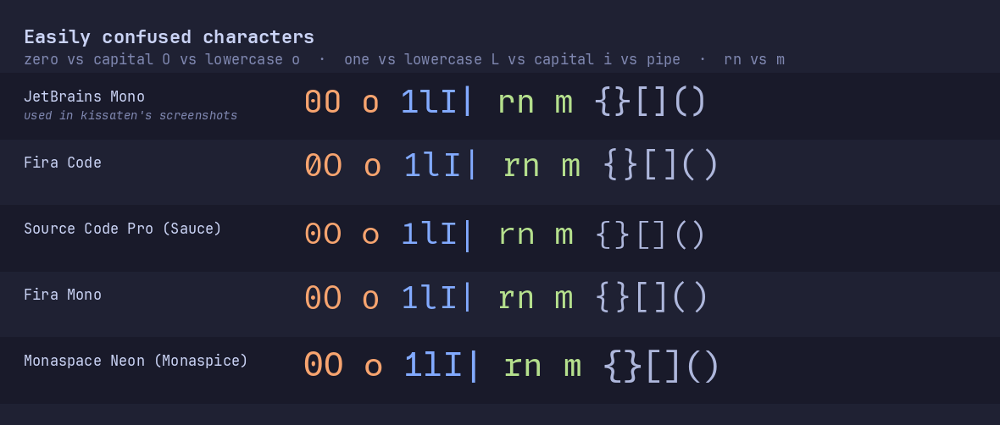
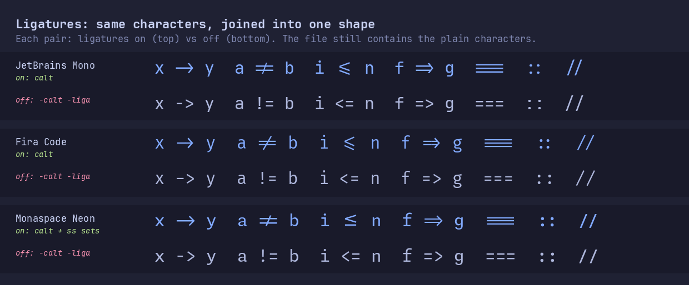

# Fonts for kissaten

A colorscheme is only half of what you see. The other half is the font. This guide covers the font kissaten's screenshots use, a few other excellent choices, and how to set them up in popular terminals and editors.

**TL;DR (macOS):**

```sh
brew install --cask font-jetbrains-mono-nerd-font
```

Then set your terminal's font to **`JetBrainsMono Nerd Font`**. Setup for each terminal and editor is [below](#set-the-font-in-your-terminal-or-editor).

## Contents

- [The recommended fonts](#the-recommended-fonts)
- [Install](#install)
- [What makes a good coding font](#what-makes-a-good-coding-font)
- [Nerd Fonts: what the patching adds](#nerd-fonts-what-the-patching-adds)
- [Find the exact font name](#find-the-exact-font-name)
- [Set the font in your terminal or editor](#set-the-font-in-your-terminal-or-editor)
- [Ligatures](#ligatures)
- [Credits](#credits)

## The recommended fonts

| Font | Homebrew cask | Name to use in your config | Zero | Ligatures | Italic |
| --- | --- | --- | --- | --- | --- |
| **JetBrains Mono** (used in kissaten's screenshots) | `font-jetbrains-mono-nerd-font` | `JetBrainsMono Nerd Font` | dotted | yes | yes |
| **Fira Code** | `font-fira-code-nerd-font` | `FiraCode Nerd Font` | slashed | yes, the most of any here | no |
| **Source Code Pro** | `font-sauce-code-pro-nerd-font` | `SauceCodePro Nerd Font` | dotted | no | yes |
| **Fira Mono** | `font-fira-mono-nerd-font` | `FiraMono Nerd Font` | dotted | no | no |
| **Monaspace** | `font-monaspice-nerd-font` | `MonaspiceNe Nerd Font` (or `Ar`, `Xe`, `Rn`, `Kr`) | dotted | opt-in, plus "texture healing" | yes |

The names, ligatures and italics above were checked against the actual Nerd Fonts 3.5.1 files these casks install.

- **JetBrains Mono** has a tall x-height, so lowercase letters stay readable at small sizes, and its letterforms were designed for reading code all day. If you want it without ligatures, the same download includes `JetBrainsMonoNL Nerd Font` ("NL" = no ligatures).
- **Fira Code** is Fira Mono with a large set of programming ligatures added. It's the font that made coding ligatures popular.
- **Source Code Pro** is Adobe's first open-source font: clean, neutral and very even. Nerd Fonts calls it *Sauce* Code Pro (see [why](#nerd-fonts-what-the-patching-adds)).
- **Fira Mono** is Mozilla's monospaced Fira, the ligature-free original that Fira Code is built on. Pick it if you like Fira Code's shapes but not ligatures.
- **Monaspace** from GitHub Next is a family of five fonts with the same metrics, so you can mix them (for example comments in Radon): **Neon** (neo-grotesque sans), **Argon** (humanist sans), **Xenon** (slab serif), **Radon** (handwriting) and **Krypton** (mechanical sans). Nerd Fonts calls them *Monaspice* `Ne`, `Ar`, `Xe`, `Rn` and `Kr`.



## Install

### macOS (Homebrew)

Font casks are part of Homebrew's main cask repository, so no tap is needed:

```sh
# the font used in kissaten's screenshots
brew install --cask font-jetbrains-mono-nerd-font

# other good choices
brew install --cask font-fira-code-nerd-font
brew install --cask font-sauce-code-pro-nerd-font
brew install --cask font-fira-mono-nerd-font
brew install --cask font-monaspice-nerd-font
```

Restart your terminal or editor afterwards so it sees the new fonts.

### Linux

Download from the [Nerd Fonts releases](https://github.com/ryanoasis/nerd-fonts/releases/latest) into your user font folder, then rebuild the font cache:

```sh
for font in JetBrainsMono FiraCode SourceCodePro FiraMono Monaspace; do
  mkdir -p ~/.local/share/fonts/"$font"
  curl -fsSL "https://github.com/ryanoasis/nerd-fonts/releases/latest/download/$font.tar.xz" |
    tar -xJ -C ~/.local/share/fonts/"$font"
done
fc-cache -f ~/.local/share/fonts
```

Many distributions also package Nerd Fonts (Arch: `ttf-jetbrains-mono-nerd`, for example).

### Windows

Download a `.zip` from the [Nerd Fonts releases](https://github.com/ryanoasis/nerd-fonts/releases/latest), extract it, select the `.ttf` files, right-click and choose **Install** (or **Install for all users**).

## What makes a good coding font

- **Every character has the same width.** Code is aligned by columns: indentation, tables, ASCII diagrams, and Vim's visual block mode all depend on a perfect grid.
- **Confusable characters look different.** You should never have to guess whether you're looking at `0` or `O`, `1`, `l`, `I` or `|`, or `rn` versus `m`. All five fonts here mark the zero (four with a dot, Fira Code with a slash) and give `1`, `l` and `I` clearly different shapes, as the image above shows. That's the difference between `l0g1n` and `logIn` being obvious or a twenty-minute bug.
- **Punctuation is easy to see.** Code is full of `.` `,` `;` `:` `` ` `` `'` `"`. A good coding font draws them large and distinct, so `.` versus `,` and `:` versus `;` don't depend on squinting.
- **Spacing and x-height.** Generous line spacing and a tall x-height keep dense code readable at small sizes. If text feels cramped, raise line spacing in your terminal before shrinking the font.
- **A real italic.** kissaten italicizes comments and keywords. JetBrains Mono, Source Code Pro and Monaspace ship true italic faces. **Fira Code and Fira Mono have no italic**, so your terminal fakes one by slanting the upright letters (or shows none). If that looks off, set `no_italic = true` in kissaten, or pick one of the other three.
- **Icons (Nerd Fonts).** LazyVim's file explorer, statusline, completion menu and dashboard draw icons from the Nerd Fonts set. Without a Nerd Font you'll see empty boxes instead.

## Nerd Fonts: what the patching adds

[Nerd Fonts](https://github.com/ryanoasis/nerd-fonts) takes existing open-source fonts and *patches* them: it adds over 10,000 icons from popular icon sets (Font Awesome, Material Design Icons, Devicons, Octicons, Codicons, Powerline symbols, Weather, Font Logos and Pomicons) to each font without changing its letters. That's why all the casks above end in `-nerd-font`.

Each patched font comes in three variants:

| Variant | Example name | Icons | Use it when |
| --- | --- | --- | --- |
| *(no suffix)* | `JetBrainsMono Nerd Font` | can be up to two cells wide | your terminal handles wide icons (Ghostty, Kitty, WezTerm, iTerm2: start here) |
| **Mono** | `JetBrainsMono Nerd Font Mono` | squeezed into one cell | icons overlap the next character or get cut off |
| **Propo** | `JetBrainsMono Nerd Font Propo` | proportional spacing | UI text and other non-grid uses, not terminals |

Patching keeps each font's ligatures (the Mono variants included), so JetBrains Mono and Fira Code still have them.

**Why "Sauce" and "Monaspice"?** Source Code Pro and Monaspace use a *Reserved Font Name* under the SIL Open Font License, which means modified versions can't use the original name. Nerd Fonts renames them, hence `SauceCodePro` and `Monaspice`.

## Find the exact font name

Your config needs the font's *family name* exactly, and it's usually not the file name. Ask your system:

```sh
# Linux (and macOS after `brew install fontconfig`)
fc-list : family | cut -d, -f1 | grep -i "nerd font" | sort -u
```

```text
JetBrainsMono Nerd Font
JetBrainsMono Nerd Font Mono
JetBrainsMono Nerd Font Propo
...
```

`fc-list` prints every alias separated by commas; the `cut` keeps the first, which is the name to use. Some terminals have their own font lister:

| Terminal | Command |
| --- | --- |
| Ghostty | `ghostty +list-fonts` |
| Kitty | `kitten choose-fonts` (interactive, with previews) |
| WezTerm | `wezterm ls-fonts --list-system` |
| macOS without fontconfig | open **Font Book**; the family name is the bold heading |

Kitty's `font_features` option is the one place that wants the **PostScript name** (one per face) instead:

```sh
fc-list : postscriptname | grep -i jetbrains   # e.g. JetBrainsMonoNF-Regular
```

## Set the font in your terminal or editor

Neovim in a terminal uses the **terminal's** font, so set it there. `guifont` only matters in GUI front-ends like Neovide.

### Ghostty

`~/.config/ghostty/config`:

```ini
font-family = "JetBrainsMono Nerd Font"
font-size = 14

# ligatures are on by default; to turn them off:
# font-feature = -calt
```

### iTerm2

iTerm2 has no config file for fonts; set them per profile in the GUI.

1. Open **iTerm2 → Settings** (<kbd>⌘</kbd><kbd>,</kbd>) → **Profiles**, select your profile, then the **Text** tab.
2. Under **Font**, click the font name and pick **`JetBrainsMono Nerd Font`**, style **Regular**, size 13–15. The list shows family names, the same ones `fc-list` prints.
3. Make sure **Italic text** is ticked so kissaten's italic comments and keywords show. iTerm2 needs a font with a real italic for this (JetBrains Mono, Source Code Pro and Monaspace have one; Fira Code and Fira Mono don't).
4. Tick **Draw bold text in bold font** for real bold instead of a smeared fake.

**Ligatures:** tick **Ligatures** in the same section to turn them on; untick it to turn them off. iTerm2's docs warn that ligatures turn off the GPU renderer and draw text through a slower path, so on older Macs you may prefer to leave them off. The font picker's options menu also has a **Contextual Alternates** toggle that turns off `calt` alone (for example, Monaspace drawing `[]` as a checkbox). iTerm2's docs mention no setting for stylistic sets, so Monaspace's opt-in `ss01`–`ss10` ligatures (see [Ligatures](#ligatures)) may not show; pick a terminal like Ghostty, Kitty or WezTerm if you want them.

**Icons:** with a Nerd Font you're done. Other options:

- **Use built-in Powerline glyphs** makes iTerm2 draw the statusline separators itself. They often line up better with the cells, so it's worth trying if your lualine edges look slightly off.
- To keep a font that *isn't* patched, tick **Use a different font for non-ASCII text** and pick a Nerd Font there, or use **Special Exceptions → Install Nerd Font Bundle** to pull just the icon ranges from one.

### Kitty

`~/.config/kitty/kitty.conf` (or run `kitten choose-fonts`):

```conf
font_family      family="JetBrainsMono Nerd Font"
font_size        14.0

# never (default) = always show ligatures
# cursor          = show plain characters under the cursor
# always          = never show ligatures
disable_ligatures never
```

### WezTerm

`~/.config/wezterm/wezterm.lua`:

```lua
local wezterm = require("wezterm")
local config = wezterm.config_builder()

config.font = wezterm.font("JetBrainsMono Nerd Font")
config.font_size = 14

-- ligatures are on by default; to turn them off:
-- config.harfbuzz_features = { "calt=0", "clig=0", "liga=0" }

return config
```

### Alacritty

`~/.config/alacritty/alacritty.toml`:

```toml
[font]
normal = { family = "JetBrainsMono Nerd Font", style = "Regular" }
size = 14
```

Alacritty doesn't render ligatures. Its maintainers have declined it for performance and code-quality reasons ([alacritty#50](https://github.com/alacritty/alacritty/issues/50)), so the ligature fonts simply show plain characters there.

### Windows Terminal

**Settings → Open JSON file**, in your profile (or `profiles.defaults`):

```jsonc
"font": {
  "face": "JetBrainsMono Nerd Font",
  "size": 12
  // ligatures are on by default; to turn them off:
  // "features": { "calt": 0, "liga": 0 }
}
```

### VS Code

`settings.json`. Unlike the terminals above, VS Code has ligatures **off** by default:

```jsonc
"editor.fontFamily": "'JetBrainsMono Nerd Font', monospace",
"editor.fontLigatures": true,

"terminal.integrated.fontFamily": "'JetBrainsMono Nerd Font'",
"terminal.integrated.fontLigatures.enabled": true
```

### Neovide

In your Neovim config:

```lua
if vim.g.neovide then
  vim.o.guifont = "JetBrainsMono Nerd Font:h14"
end
```

Font features go in Neovide's `config.toml`:

```toml
[font]
normal = ["JetBrainsMono Nerd Font"]
size = 14

[font.features]
"JetBrainsMono Nerd Font" = ["-calt"]   # only if you want ligatures off
```

## Ligatures

A ligature draws several characters as one shape: `->` becomes a real arrow, `!=` becomes `≠`, `<=` becomes `≤`. The file is unchanged. It still contains `-` and `>`, and the cursor still moves over each character.



Whether you like them is a matter of taste. Some people find `≠` faster to read; others prefer to see exactly what they typed. All of these setups let you choose.

**The detail that trips people up:** coding fonts implement ligatures through the OpenType feature **`calt`** (contextual alternates), not `liga`. In the Nerd Fonts files above, JetBrains Mono and Fira Code apply all their coding ligatures through `calt`. So to turn ligatures **off**, disable `calt` (and `liga`, to be thorough). Disabling only `liga` usually changes nothing.

| Font | Ligatures by default | Notes |
| --- | --- | --- |
| JetBrains Mono | on | `JetBrainsMonoNL Nerd Font` is the same font without them |
| Fira Code | on | extra stylistic sets `ss01`–`ss10` and character variants change individual glyphs |
| Source Code Pro | none | |
| Fira Mono | none | |
| Monaspace | mostly off | coding ligatures are opt-in stylistic sets, see below |

**Monaspace** splits its coding ligatures into ten opt-in groups, so you enable the ones you like:

| Set | Ligatures |
| --- | --- |
| `ss01` | equals: `!=` `===` |
| `ss02` | comparisons: `<=` `>=` |
| `ss03` | arrows: `->` `~>` |
| `ss04` | markup: `</` `/>` |
| `ss05` | F#: `\|>` |
| `ss06` | repeated `#` `+` `_` `=` `&` |
| `ss07` | colons: `::` `=:=` |
| `ss08` | periods: `..=` `.-` |
| `ss09` | `<=>` `>>` `=<<` |
| `ss10` | other tags: `#[` `#(` |

Its signature feature, **texture healing**, also runs on `calt`: it lets wide letters like `m` borrow space from narrow neighbours like `i`, so text looks less gappy while staying on the grid. Leave `calt` on to keep it. For example, in Ghostty:

```ini
font-family = "MonaspiceNe Nerd Font"
font-feature = ss01
font-feature = ss02
font-feature = ss03
```

**Tip for Kitty users:** `disable_ligatures cursor` shows ligatures everywhere except the word under the cursor. That's handy when you're editing operators.

## Credits

Every font here is free and open source under the [SIL Open Font License 1.1](https://openfontlicense.org). Thank you to their designers:

- **[JetBrains Mono](https://github.com/JetBrains/JetBrainsMono)** by JetBrains (Philipp Nurullin, Konstantin Bulenkov and contributors).
- **[Fira Code](https://github.com/tonsky/FiraCode)** by Nikita Prokopov, built on Fira Mono.
- **[Source Code Pro](https://github.com/adobe-fonts/source-code-pro)** by Paul D. Hunt for Adobe.
- **[Fira Mono](https://github.com/mozilla/Fira)** by Carrois Apostrophe for Mozilla.
- **[Monaspace](https://github.com/githubnext/monaspace)** by GitHub Next and Lettermatic.
- **[Nerd Fonts](https://github.com/ryanoasis/nerd-fonts)** by Ryan L McIntyre and contributors, which patches all of the above with icons. The patched fonts keep the OFL; Nerd Fonts' own scripts are MIT-licensed.

The comparison images in this folder are rendered from the Nerd Fonts 3.5.1 files themselves, in kissaten's evening colors.
