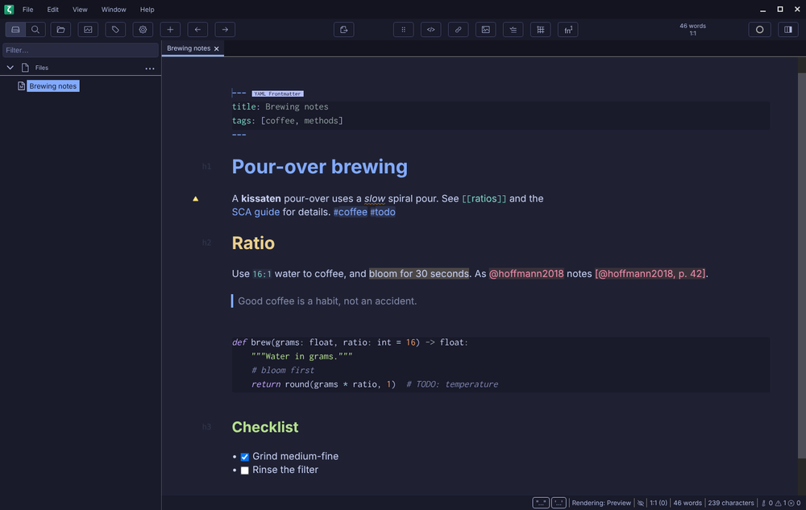
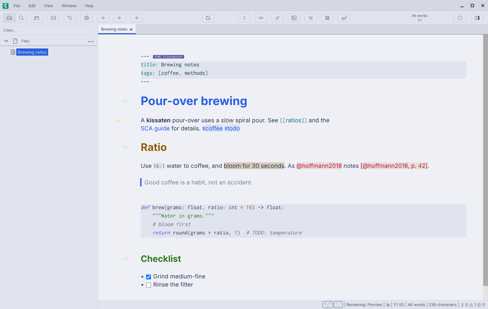

# kissaten for Zettlr

[kissaten.nvim](../../README.md) theme for [Zettlr](https://www.zettlr.com), generated from the same palettes as the Neovim colorscheme.

Every file comes in all five styles (`kissaten_morning`, `kissaten_afternoon`, `kissaten_evening`, `kissaten_midnight`, `kissaten_graveyard`). The examples use `evening`; swap in the style you want. Replace `curl … -o` with a plain copy if you've cloned the repo.

## Install

Zettlr takes a single Custom CSS. Each kissaten file applies in one Zettlr mode only (`morning` in light mode, the others in dark mode), so paste a light and a dark file together to follow Zettlr's dark-mode switch:

```sh
base=https://raw.githubusercontent.com/bytebeast/kissaten.nvim/main/extras/zettlr
curl -fsSL "$base/kissaten_morning.css" "$base/kissaten_evening.css" | pbcopy   # Linux: | xclip -selection clipboard
```

Open **Zettlr → Assets Manager** (macOS) or **File → Preferences → Assets Manager** (Windows/Linux), choose **Custom CSS**, paste and save. It themes the editor, code blocks, file manager, toolbar, tabs and status bar, and sets Zettlr's accent color to kissaten blue (the CSS marks the two lines to delete if you'd rather keep your OS accent).

## Screenshots

Zettlr 4.8 in dark mode (`evening`) and light mode (`morning`):



